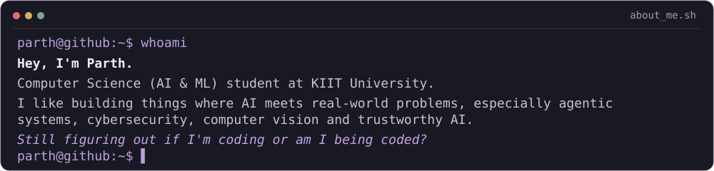
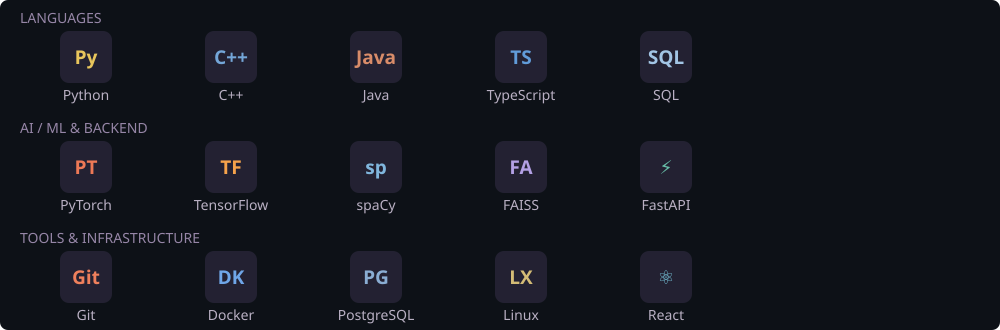

  
  

## 

- AI security and privacy-preserving systems
- Multi-agent workflows and production RAG
- Trustworthy and explainable AI
- AI systems engineering and cloud deployment

## 

## 

## 

**Contribution snake**

---

## 

  
  &nbsp;&nbsp;&nbsp;
  
  &nbsp;&nbsp;&nbsp;
  
  &nbsp;&nbsp;&nbsp;
  

まだまだこれから。

The journey is just beginning.

DESIGNED WITH CURIOSITY · BUILT WITH PURPOSE

